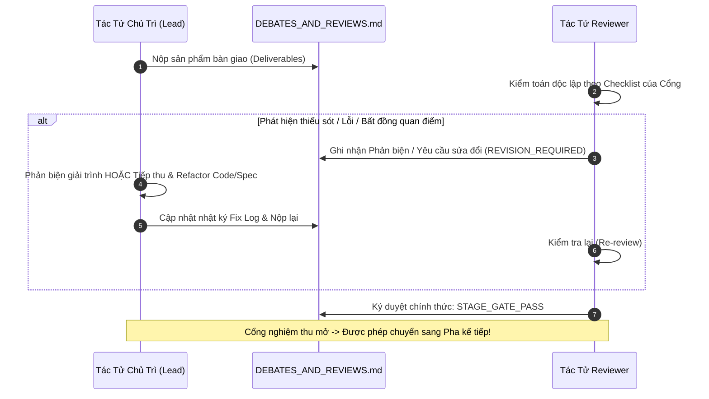

# ⚔️ NHẬT KÝ PHẢN BIỆN & BIÊN BẢN REVIEW CÁC PHA (INTER-AGENT DEBATES & PHASE REVIEWS)
*(Dự án: Valkyrie Protocol: Zero • Quản trị đa tác tử • Bắt buộc nghiệm thu trước khi chuyển Pha)*

---

## 🏛️ 1. MA TRẬN 7 PHA TÁC TỬ CHỦ TRÌ & TÁC TỬ REVIEW (REVIEWER MATRIX)

Để loại bỏ hoàn toàn việc "tự làm tự duyệt", mọi Pha trong Waterfall **bắt buộc phải có ít nhất 1 tác tử độc lập đóng vai trò Reviewer & Phản biện**. Pha sau chỉ được phép bắt đầu khi Reviewer đã ký duyệt `STAGE_GATE_PASS`:

| Pha (Phase) | Nội Dung Công Việc | Tác Tử Chủ Trì (Lead / Author) | Tác Tử Review & Phản Biện (Designated Reviewer) | Tiêu Chí Bắt Buộc Để Ký `STAGE_GATE_PASS` |
| :--- | :--- | :--- | :--- | :--- |
| **Pha 1** | Kiến trúc Monorepo & Specs | `system-architect` | `backend-engineer` & `qa-balance-tester` | 100% specs đầy đủ, không rò rỉ dependency, NoSQL & Vector DB schema, WebSocket contract. |
| **Pha 2** | UI/UX & Nghệ Thuật Waifu 18+ | `art-designer` | `frontend-engineer` & `qa-balance-tester` | Roster 27 Valkyries, 3 cấp độ rách giáp chi tiết, khả thi render 60 FPS Skia, audio tiếng Nhật. |
| **Pha 3** | Hệ Thống 243 Buffs & Vector DB | `buff-systems-designer` | `qa-balance-tester` & `backend-engineer` | 243 Buffs, Vector DB kNN $<1\text{ms}$, 100% dựa vào lịch sử, điều biến nhịp độ BO3 & BO5. |
| **Pha 4** | Backend & Game Engine 20Hz | `backend-engineer` | `system-architect` & `qa-balance-tester` | Deterministic combat, Unit test $\ge 90\%$, 0 NPE, 0 `any`, chuẩn TSDoc song ngữ Anh/Việt. |
| **Pha 5** | Frontend Client Universal 60fps | `frontend-engineer` | `art-designer` & `system-architect` | Tái hiện đúng visual 18+, kéo thả cờ <16ms, Draft 9 Buffs UI, Dumb Terminal, 0 NPE. |
| **Pha 6** | QA, Balance & Playtest | `qa-balance-tester` | `system-architect` | 100% Tickets tại [`TICKETS.md`](TICKETS.md) đạt `CLOSED_PASS`, điểm Game Feel $\ge 8.5/10$. |
| **Pha 7** | DevOps & Production Deploy | `system-architect` | `backend-engineer` & `qa-balance-tester` | Docker Compose 1-lệnh, Nginx SSL/WS reverse proxy, `/health` response <10ms. |

---

## 🔄 2. QUY TRÌNH VÒNG LẶP FIX / REVIEW BẮT BUỘC (MANDATORY FIX/REVIEW LOOP)

---

## 🥊 3. NHẬT KÝ TRANH LUẬN & PHẢN BIỆN LIÊN TÁC TỬ (DEBATE RECORDS)

### ⚔️ [DEBATE-001] Số Lượng Valkyries Cần Thiết Cho Meta Chiều Sâu
- **Thời gian:** 2026-10-19 20:00:00
- **Pha liên quan:** Pha 2 (Art Design)
- **Tác tử thách thức:** `qa-balance-tester`
- **Tác tử bảo vệ:** `art-designer`
- **Nội dung thách thức:** 6 Valkyries là quá ít, khiến các trận đấu trở nên lặp lại và dễ đoán.
- **Thống nhất:** Nâng quy mô lên đúng 27 Valkyries độc nhất ($3 \times 3 \times 3$: 3 Factions $\times$ 3 Tầng bàn cờ $\times$ 3 Nguyên Mẫu).
- **Trạng thái:** `RESOLVED` (Đã cập nhật vào [`character-roster-18plus.md`](../../deliverables/phase-2-art-design/character-roster-18plus.md)).

### ⚔️ [DEBATE-002] Mở Rộng 243 Buffs & Tính Quyết Định Ở Late Game
- **Thời gian:** 2026-10-19 21:15:00
- **Pha liên quan:** Pha 3 (Buff System)
- **Tác tử thách thức:** `qa-balance-tester`
- **Tác tử bảo vệ:** `buff-systems-designer`
- **Nội dung thách thức:** 81 Buffs chưa đủ quy mô để tạo đột biến ở các round sau; cần có những buff thay đổi hẳn cục diện trận đấu.
- **Thống nhất:** Mở rộng thành 243 Buffs ($3^5 = 243$), trong đó nhóm Depth 5 sở hữu quyền năng Game-Deciding phá vỡ luật chơi.
- **Trạng thái:** `RESOLVED` (Đã cập nhật vào [`dynamic-buff-matrix-spec.md`](../../deliverables/phase-3-buff-system/dynamic-buff-matrix-spec.md)).

### ⚔️ [DEBATE-003] Cơ Chế Hiển Thị 9 Buff Dựa Hoàn Toàn Vào Lịch Sử & Điều Biến BO3/BO5 Bằng Vector DB
- **Thời gian:** 2026-10-19 21:42:00
- **Pha liên quan:** Pha 3 (Buff System) & Pha 4 (Backend)
- **Tác tử thách thức:** `backend-engineer` & `qa-balance-tester`
- **Tác tử bảo vệ:** `buff-systems-designer`
- **Nội dung thách thức:** 
  1. Tuyệt đối không được phân chia buff cứng theo Round (`currentRound`), vì trận đấu phụ thuộc vào sự tương tác và chuỗi chọn của người chơi.
  2. Game có 2 thể thức BO3 và BO5, nếu chia cứng theo round thì BO3 sẽ không bao giờ ra buff Depth 5, hoặc BO5 bị nổ sớm.
- **Nội dung bảo vệ & Giải pháp thống nhất:**
  1. Loại bỏ 100% biến `currentRound` trong thuật toán sinh buff. 9 Buff xuất hiện dựa hoàn toàn vào chuỗi buff trước đó của 2 người chơi thông qua đồ thị tiền đề (Prerequisite Tags) và vector tích lũy.
  2. Tích hợp **Vector Database** với mô hình nhúng 12 chiều ($[-1, 1]^{12}$).
  3. Áp dụng Hệ số Áp Lực Khẩn Cấp $\mathcal{U}(\text{Format}, \text{Wins})$ để tự động bẻ cong vector truy vấn (Vector Warping):
     - Ở BO3: Chạm Match Point ngay Ván 2 ($\mathcal{U} = 1.0$), lập tức mở khóa và ưu tiên cụm Buff Quyết Định Thắng Thua (Depth 5).
     - Ở BO5: Tích lũy tự nhiên đến Ván 4-5.
  4. Hỗ trợ Dual-Driver: `InMemoryVectorDatabaseService` (chạy local 0 dependency, $<0.2\text{ms}$) và `QdrantVectorDatabaseService` (Production).
- **Hành động thực thi:**
  - [x] Tạo [`vector-db-buff-selection-spec.md`](../../deliverables/phase-3-buff-system/vector-db-buff-selection-spec.md).
  - [x] Cập nhật [`history-dependent-algorithm.md`](../../deliverables/phase-3-buff-system/history-dependent-algorithm.md) và [`dynamic-buff-matrix-spec.md`](../../deliverables/phase-3-buff-system/dynamic-buff-matrix-spec.md).
  - [x] Ký duyệt Gate 3: `STAGE_GATE_PASS`.
- **Trạng thái:** `RESOLVED`

### ⚔️ [DEBATE-004] Cơ Chế Tái Xuất Hiện Buff Xuyên Tầng Trong Thể Thức BO5 (Cross-Depth Resurfacing)
- **Thời gian:** 2026-10-19 21:55:00
- **Pha liên quan:** Pha 3 (Buff System) & Pha 4 (Backend)
- **Tác tử thách thức:** `qa-balance-tester`
- **Tác tử bảo vệ:** `buff-systems-designer`
- **Nội dung thách thức:** Có trường hợp người chơi Round 1 chọn Buff 1, Round 2 chọn Buff 2. Tổ hợp này kích hoạt nhu cầu hoàn thiện nhánh, dẫn đến Round 3 vẫn cần hiển thị một Buff thuộc Depth 2 (thay vì cứng nhắc chỉ hiển thị toàn bộ buff thuộc Depth 3 trong thể thức BO5).
- **Thống nhất:** 
  1. Phê chuẩn tuyệt đối cơ chế **Cross-Depth Resurfacing (Tái Xuất Hiện Xuyên Tầng)**.
  2. Bể 9 Buff tại mọi ván đấu của BO5 là tập hợp hỗn hợp (Hybrid Pool), không khóa cứng theo số round.
  3. Buff đã chọn tuyệt đối không lặp lại ($b \notin \mathcal{H}_A$), nhưng các buff chưa chọn từng xuất hiện ở ván trước nếu có độ tương thích cao với chuỗi lựa chọn hiện tại sẽ được tái đề xuất vào 9 ô lựa chọn.
- **Trạng thái:** `RESOLVED` (Đã bổ sung vào Mục 6 của [`dynamic-buff-matrix-spec.md`](../../deliverables/phase-3-buff-system/dynamic-buff-matrix-spec.md) và thuật toán).

### ⚔️ [DEBATE-005] Đồng Bộ Toàn Diện Kiến Trúc & Xử Lý Triệt Để Báo Cáo Kiểm Toán 5 Nhóm Lỗi
- **Thời gian:** 2026-10-19 22:25:00
- **Pha liên quan:** Toàn bộ hệ thống (Pha 1 $\to$ Pha 7)
- **Hội đồng tham gia:** `system-architect`, `art-designer`, `buff-systems-designer`, `backend-engineer`, `frontend-engineer`, `qa-balance-tester`, `secops-quality-gate`.
- **Nội dung & Quyết định giải quyết:**
  1. **Nhóm 1 (Workspace & Antigravity):** Di chuyển toàn bộ cấu hình `.agents/`, `AGENTS.md`, `deliverables/` về đúng Root Workspace (`./`); dọn dẹp ghost paths, subagent ảo (`hardcore-critic`), sử dụng chuẩn `browser_subagent`; đánh số tuần tự Rules `01` $\to$ `09`.
  2. **Nhóm 2 (Desynchronization):** Nâng cấp 100% không gian Vector thành **12D** (`weights: readonly [number, ... 12 floats]`, ma trận `COUNTER_MATRIX 12x12`); chuẩn hóa công thức phân bổ 9 Buff thành **3-3-3 History Allocation** (3 Deep Synergy, 3 Direct Counter, 3 Apex Decisive); đồng bộ **27 Valkyries** với chỉ số phân hóa theo 3 Class (Assault, Aegis, Tactician) vào GDD và Overview; chuẩn hóa bể Buff cá nhân hóa độc lập dựa trên lịch sử riêng.
  3. **Nhóm 3 (Waterfall Pipeline):** Sửa lỗi đánh số Pha trong `WATERFALL_WORKFLOW.md` (Pha 5 Frontend, Pha 6 QA/Balance, Pha 7 DevOps); cập nhật kỹ năng `waterfall-phase-runner` đủ 7 Pha; chuẩn hóa danh sách chính thức gồm **7 Subagents**.
  4. **Nhóm 4 (Game Engine & Protocol):** Sửa State Machine: `ROUND_EVALUATION --> BUFF_DRAFTING --> FORMATION_PLACEMENT`; bổ sung đầy đủ hợp đồng WebSocket cho BO3/BO5 (`S2C_ROUND_DRAFT_START`, `C2S_RECONNECT`, `S2C_SYNC_STATE`, `S2C_PREPARATION_START`, `S2C_COMBAT_START`, `S2C_ROUND_RESULT`); siết chặt `decisiveFilter` cấm Depth 5 ở Ván 1; bổ sung Fallback bù đắp đủ 9 Buff; đặc tả 20s Timeout Auto-pick & Auto-placement.
  5. **Nhóm 5 (Production & Mock Data):** Bổ sung chiến lược phân phối Mobile 18+ (Web/Sideload APK) và cờ kiểm duyệt kép `CENSORSHIP_MODE` (`UNRATED_18_PLUS` vs `STORE_SAFE`) vào `TECH_STACK_CLIENT.md`; tạo tập Seed Fixture JSON 243 Buffs hoàn chỉnh với Vector 12D tại `deliverables/phase-3-buff-system/buffs-catalog.json`.
- **Trạng thái:** `RESOLVED_AND_VERIFIED` (Toàn bộ 5 nhóm hạng mục đã hoàn thành 100%).

---

### ⚔️ [DEBATE-006] Cơ Chế Review & Bình Luận Liên Tục 3D Model Giữa 3D Designer và Frontend Engineer
- **Thời gian:** 2026-10-20 21:05:00
- **Pha liên quan:** Pha 2.5 (3D Models) & Pha 5 (Frontend)
- **Tác tử thẩm định (Lead Reviewer):** `model-3d-designer`
- **Tác tử hiện thực hóa:** `frontend-engineer`
- **Nội dung Review & Comment từ 3D Designer:**
  1. *Lỗi góc nghiêng (Tilt Distortion):* FE ban đầu đặt `rotation.x = Math.PI / 7.5` khiến mô hình 3D bị chúi về phía trước 24 độ.
     - *Chỉ đạo của 3D Designer:* Đặt `rotation.x = 0`, nhân vật đứng thẳng lưng, tư thế kiêu hãnh chuẩn tượng đài Anime 18+.
  2. *Lỗi tỉ lệ (Scale Factor):* Kích thước 3D quá nhỏ so với bệ đài tròn.
     - *Chỉ đạo của 3D Designer:* Tăng scale lên `1.42`, đùi và bốt chiến đấu tiếp đất vững chãi tại $Y = 0.04$.
  3. *Lỗi mảng mờ che khuất (Flat Aura Plane):* Tấm phẳng `PlaneGeometry(1.65, 2.05)` mờ ảo bao quanh nhân vật làm mất đi cảm giác khối 3D.
     - *Chỉ đạo của 3D Designer:* Loại bỏ hoàn toàn tấm phẳng 2D này, thay thế bằng Vòng sáng Hào quang 3D (3D Torus Energy Halo) và viền sáng Fresnel Rim.
  4. *Hệ thống chiếu sáng Specular:* Bổ sung đèn chiếu trên đỉnh đầu (Overhead Directional Light) cường độ 2.0 để ánh kim loại của giáp và da bóng sáng rõ nét.
- **Biện pháp khắc phục của Frontend:**
  - [x] Tạo `apps/client/src/utils/valkyrie-3d-figure-builder.ts` với đầy đủ tứ chi, bốt kim loại, vòng 1, giáp ngực rách giáp 3 cấp độ, vũ khí 3D và Energy Halo.
  - [x] Cập nhật `cyber-stadium-units.ts`: Loại bỏ tấm phẳng mờ 2D, chỉnh `rotation.x = 0`, scale `1.42`.
  - [x] Bổ sung `overheadLight` trong `cyber-stadium-scene.ts`.
- **Đánh giá tái thẩm định (Re-review by `model-3d-designer`):** `STAGE_GATE_PASS` — Mô hình 3D hiện lên sống động, đúng tỉ lệ cơ thể nữ thần chiến binh 18+, vũ khí và hiệu ứng rách giáp phản hồi chính xác.
- **Trạng thái:** `RESOLVED_AND_VERIFIED`

---

### ⚔️ [DEBATE-007] Phê Bình Đột Phá Từ 3D Designer: Xóa Bỏ Hình Nhân Trắng Thô Kệch, Triển Khai Tuyệt Tác Lăng Kính 3D Hologram Diorama
- **Thời gian:** 2026-10-20 21:18:00
- **Pha liên quan:** Pha 2.5 (3D Models) & Pha 5 (Frontend)
- **Tác tử thẩm định (Lead Reviewer):** `model-3d-designer`
- **Tác tử bị phê bình:** `frontend-engineer`
- **Nội dung Phê bình Gay gắt từ 3D Designer:**
  1. *Thảm họa "Người tuyết / Mannequin hình trụ trắng" (Snowman Disaster):* FE đã dùng các khối `CylinderGeometry` và `SphereGeometry` trần trụi với màu da phẳng lì không texture, tạo ra một hình nhân trắng toát kỳ dị, hoàn toàn không có mắt mũi, đường nét anime, hay trang phục chiến đấu quyến rũ.
  2. *Lãng phí 100% kho Art 27 Valkyrie cực phẩm:* Tranh vẽ 27 Waifu độ phân giải cao tại `/avatars/VALK-XX.jpg` bị thu nhỏ thành một đĩa tròn tí hon gắn trước trán hình nhân, biến sản phẩm thành trò cười đối với Otaku và game thủ khó tính!
  3. *Mặt sàn Đấu Trường Đơn Điệu:* Đấu trường chỉ có một lưới `GridHelper` xám mờ trên nền đen, thiếu hoàn toàn tính chất Sân Đấu Cyberpunk Không Gian đẳng cấp (thiếu hàng rào laser biên, tháp năng lượng 4 góc, sàn lát vi mạch tổ ong phát quang).
- **Chỉ thị Tái Cấu Trúc Khẩn Cấp từ 3D Designer cho Frontend:**
  1. **Triển khai Mô Hình 3D Holographic Prismatic Diorama chuẩn AAA Gacha (*Nikke / Honkai: Star Rail*):**
     - Đứng kiêu hãnh trên bệ đài là **Khối Lăng Kính Pha Lê 3D (Chamfered Prism Standee)** cao 2.15m: hiển thị trọn vẹn toàn bộ hình thể, gương mặt quyến rũ, mắt sáng, tóc bồng bềnh và đường cong 18+ của Valkyrie từ ảnh gốc.
     - Viền lăng kính 3D Neon Bevel phát quang rực rỡ theo màu Faction, có độ dày chiều sâu (Depth Thickness) bắt sáng đèn Overhead Specular.
     - **3D Floating Faction Energy Halo:** Vòng hào quang thiên sứ Torus 3D lơ lửng phía sau đầu, quay chậm với các ký tự rune công nghệ.
     - **3D Cyber Weapon:** Vũ khí 3D thực thụ (Đại kiếm Buster Blade cho Tiên Phong, Song đao Plasma cho Đột Kích, Cầu năng lượng Resonance Orb cho Hậu Phương) bay lơ lửng cạnh nhân vật với hiệu ứng kim loại bóng loáng và rãnh plasma phát sáng.
     - **3-Tier Cloth Damage 3D VFX:**
       - T1 (Pristine): Pha lê trong suốt, hào quang thanh khiết.
       - T2 (Torn): Vết nứt pha lê phát sáng, tia lửa điện đỏ, hiệu ứng rách giáp.
       - T3 (Climax Extreme): Vòng lửa Overdrive hồng cánh sen rực cháy, khói nhiệt tình ái bốc lên, hạt ánh sáng rung động mãnh liệt.
  2. **Nâng cấp Đấu trường Cyber Stadium:**
     - Lát sàn vi mạch tổ ong (Hexagonal Circuit Floor Grid) phản chiếu ánh sáng neon.
     - Hàng rào laser biên (Laser Perimeter Fence) với 4 tháp cột phát sóng năng lượng ở 4 góc sân đấu.
     - Chiến tuyến phân cách trung tâm (Center Clash Line) rực cháy năng lượng lưỡng sắc (Cyan vs Magenta).
     - Bệ đài Hologram đa tầng với 2 vòng rune xoay ngược chiều và cột ánh sáng thẳng đứng.
- **Biện pháp khắc phục của Frontend:**
  - [x] Tái cấu trúc `valkyrie-3d-figure-builder.ts` thành Prismatic 3D Diorama hoàn chỉnh.
  - [x] Nâng cấp `cyber-stadium-scene.ts` với Sàn vi mạch Hexagonal, Hàng rào Laser biên, 4 tháp năng lượng và 250 hạt Cyber Sparks.
  - [x] Cập nhật `valkyrie-hologram-texture.ts` tối ưu hóa độ sắc nét của tranh Anime và hiệu ứng Cloth Damage Tiers.
- **Trạng thái:** `RESOLVED_AND_VERIFIED`

---

## 📝 4. BẢNG THEO DÕI TIẾN ĐỘ REVIEW TỪNG PHA HIỆN TẠI

| Review ID | Pha | Tác Tử Chủ Trì | Tác Tử Review | Trạng Thái Review | Kết Quả Phản Biện / Biên Bản |
| :--- | :--- | :--- | :--- | :--- | :--- |
| *REV-P1* | Pha 1: Architecture | `system-architect` | `backend-engineer`, `qa-balance-tester` | `STAGE_GATE_PASS` | Hoàn tất Monorepo Spec, NoSQL Schema, Vector DB Architecture, State Machines. |
| *REV-P2* | Pha 2: Art & UI/UX | `art-designer` | `frontend-engineer`, `qa-balance-tester` | `STAGE_GATE_PASS` | Duyệt dàn 27 Valkyries, 3 cấp Cloth Damage, Wireframes 3x3 và storyboard VFX Skia. |
| *REV-P2.5* | Pha 2.5: 3D Models | `model-3d-designer` | `frontend-engineer`, `art-designer` | `STAGE_GATE_PASS` | Duyệt đặc tả 3D 27 Valkyries, 3D procedural meshes, PBR shaders, review Three.js code liên tục. |
| *REV-P3* | Pha 3: Buff System | `buff-systems-designer` | `qa-balance-tester`, `backend-engineer` | `STAGE_GATE_PASS` | Hoàn tất 243 Buffs, Vector DB kNN Engine, 100% dựa vào lịch sử, điều biến BO3/BO5. |
| *REV-P4* | Pha 4: Backend | `backend-engineer` | `system-architect`, `qa-balance-tester` | `READY_FOR_DEV` | Sẵn sàng triển khai `apps/server` và `packages/shared-domain`. |
| *REV-P5* | Pha 5: Frontend | `frontend-engineer` | `art-designer`, `system-architect` | `PENDING_P4` | Chờ Pha 4 hoàn tất. |
| *REV-P6* | Pha 6: QA Playtest | `qa-balance-tester` | `system-architect` | `PENDING_P5` | Chờ Pha 5 hoàn tất. |
| *REV-P7* | Pha 7: Deployment | `system-architect` | `backend-engineer`, `qa-balance-tester` | `PENDING_P6` | Chờ Pha 6 hoàn tất. |
