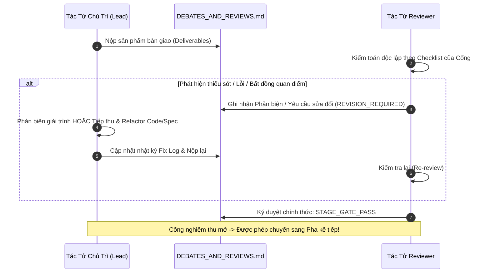

# ⚔️ NHẬT KÝ PHẢN BIỆN & BIÊN BẢN REVIEW CÁC PHA (INTER-AGENT DEBATES & PHASE REVIEWS)
*(Dự án: Valkyrie Protocol: Zero • Quản trị đa tác tử • Bắt buộc nghiệm thu trước khi chuyển Pha)*

---

## 🏛️ 1. MA TRẬN 7 PHA TÁC TỬ CHỦ TRÌ & TÁC TỬ REVIEW (REVIEWER MATRIX)

Để loại bỏ hoàn toàn việc "tự làm tự duyệt", mọi Pha trong Waterfall **bắt buộc phải có ít nhất 1 tác tử độc lập đóng vai trò Reviewer & Phản biện**. Pha sau chỉ được phép bắt đầu khi Reviewer đã ký duyệt `STAGE_GATE_PASS`:

| Pha (Phase) | Nội Dung Công Việc | Tác Tử Chủ Trì (Lead / Author) | Tác Tử Review & Phản Biện (Designated Reviewer) | Tiêu Chí Bắt Buộc Để Ký `STAGE_GATE_PASS` |
| :--- | :--- | :--- | :--- | :--- |
| **Pha 1** | Kiến trúc Monorepo & Specs | `system-architect` | `backend-engineer` & `qa-balance-tester` | 100% specs đầy đủ, không rò rỉ dependency, NoSQL & Vector DB schema, WebSocket contract. |
| **Pha 2** | UI/UX & Nghệ Thuật Waifu 18+ | `art-designer` | `frontend-engineer` & `qa-balance-tester` | Roster 27 Valkyries, 3 cấp độ rách giáp chi tiết, khả thi render 60 FPS Skia, audio tiếng Nhật. |
| **Pha 3** | Hệ Thống 243 Buffs & Vector DB | `buff-systems-designer` | `qa-balance-tester` & `backend-engineer` | 243 Buffs, Vector DB kNN $<1\text{ms}$, 100% dựa vào lịch sử, điều biến nhịp độ BO3 & BO5. |
| **Pha 4** | Backend & Game Engine 20Hz | `backend-engineer` | `system-architect` & `qa-balance-tester` | Deterministic combat, Unit test $\ge 90\%$, 0 NPE, 0 `any`, chuẩn TSDoc song ngữ Anh/Việt. |
| **Pha 5** | Frontend Client Universal 60fps | `frontend-engineer` | `art-designer` & `system-architect` | Tái hiện đúng visual 18+, kéo thả cờ <16ms, Draft 9 Buffs UI, Dumb Terminal, 0 NPE. |
| **Pha 6** | QA, Balance & Playtest | `qa-balance-tester` | `system-architect` | 100% Tickets tại [`TICKETS.md`](TICKETS.md) đạt `CLOSED_PASS`, điểm Game Feel $\ge 8.5/10$. |
| **Pha 7** | DevOps & Production Deploy | `system-architect` | `backend-engineer` & `qa-balance-tester` | Docker Compose 1-lệnh, Nginx SSL/WS reverse proxy, `/health` response <10ms. |

---

## 🔄 2. QUY TRÌNH VÒNG LẶP FIX / REVIEW BẮT BUỘC (MANDATORY FIX/REVIEW LOOP)

---

## 🥊 3. NHẬT KÝ TRANH LUẬN & PHẢN BIỆN LIÊN TÁC TỬ (DEBATE RECORDS)

### ⚔️ [DEBATE-001] Số Lượng Valkyries Cần Thiết Cho Meta Chiều Sâu
- **Thời gian:** 2026-10-19 20:00:00
- **Pha liên quan:** Pha 2 (Art Design)
- **Tác tử thách thức:** `qa-balance-tester`
- **Tác tử bảo vệ:** `art-designer`
- **Nội dung thách thức:** 6 Valkyries là quá ít, khiến các trận đấu trở nên lặp lại và dễ đoán.
- **Thống nhất:** Nâng quy mô lên đúng 27 Valkyries độc nhất ($3 \times 3 \times 3$: 3 Factions $\times$ 3 Tầng bàn cờ $\times$ 3 Nguyên Mẫu).
- **Trạng thái:** `RESOLVED` (Đã cập nhật vào [`character-roster-18plus.md`](../../deliverables/phase-2-art-design/character-roster-18plus.md)).

### ⚔️ [DEBATE-002] Mở Rộng 243 Buffs & Tính Quyết Định Ở Late Game
- **Thời gian:** 2026-10-19 21:15:00
- **Pha liên quan:** Pha 3 (Buff System)
- **Tác tử thách thức:** `qa-balance-tester`
- **Tác tử bảo vệ:** `buff-systems-designer`
- **Nội dung thách thức:** 81 Buffs chưa đủ quy mô để tạo đột biến ở các round sau; cần có những buff thay đổi hẳn cục diện trận đấu.
- **Thống nhất:** Mở rộng thành 243 Buffs ($3^5 = 243$), trong đó nhóm Depth 5 sở hữu quyền năng Game-Deciding phá vỡ luật chơi.
- **Trạng thái:** `RESOLVED` (Đã cập nhật vào [`dynamic-buff-matrix-spec.md`](../../deliverables/phase-3-buff-system/dynamic-buff-matrix-spec.md)).

### ⚔️ [DEBATE-003] Cơ Chế Hiển Thị 9 Buff Dựa Hoàn Toàn Vào Lịch Sử & Điều Biến BO3/BO5 Bằng Vector DB
- **Thời gian:** 2026-10-19 21:42:00
- **Pha liên quan:** Pha 3 (Buff System) & Pha 4 (Backend)
- **Tác tử thách thức:** `backend-engineer` & `qa-balance-tester`
- **Tác tử bảo vệ:** `buff-systems-designer`
- **Nội dung thách thức:** 
  1. Tuyệt đối không được phân chia buff cứng theo Round (`currentRound`), vì trận đấu phụ thuộc vào sự tương tác và chuỗi chọn của người chơi.
  2. Game có 2 thể thức BO3 và BO5, nếu chia cứng theo round thì BO3 sẽ không bao giờ ra buff Depth 5, hoặc BO5 bị nổ sớm.
- **Nội dung bảo vệ & Giải pháp thống nhất:**
  1. Loại bỏ 100% biến `currentRound` trong thuật toán sinh buff. 9 Buff xuất hiện dựa hoàn toàn vào chuỗi buff trước đó của 2 người chơi thông qua đồ thị tiền đề (Prerequisite Tags) và vector tích lũy.
  2. Tích hợp **Vector Database** với mô hình nhúng 12 chiều ($[-1, 1]^{12}$).
  3. Áp dụng Hệ số Áp Lực Khẩn Cấp $\mathcal{U}(\text{Format}, \text{Wins})$ để tự động bẻ cong vector truy vấn (Vector Warping):
     - Ở BO3: Chạm Match Point ngay Ván 2 ($\mathcal{U} = 1.0$), lập tức mở khóa và ưu tiên cụm Buff Quyết Định Thắng Thua (Depth 5).
     - Ở BO5: Tích lũy tự nhiên đến Ván 4-5.
  4. Hỗ trợ Dual-Driver: `InMemoryVectorDatabaseService` (chạy local 0 dependency, $<0.2\text{ms}$) và `QdrantVectorDatabaseService` (Production).
- **Hành động thực thi:**
  - [x] Tạo [`vector-db-buff-selection-spec.md`](../../deliverables/phase-3-buff-system/vector-db-buff-selection-spec.md).
  - [x] Cập nhật [`history-dependent-algorithm.md`](../../deliverables/phase-3-buff-system/history-dependent-algorithm.md) và [`dynamic-buff-matrix-spec.md`](../../deliverables/phase-3-buff-system/dynamic-buff-matrix-spec.md).
  - [x] Ký duyệt Gate 3: `STAGE_GATE_PASS`.
- **Trạng thái:** `RESOLVED`

### ⚔️ [DEBATE-004] Cơ Chế Tái Xuất Hiện Buff Xuyên Tầng Trong Thể Thức BO5 (Cross-Depth Resurfacing)
- **Thời gian:** 2026-10-19 21:55:00
- **Pha liên quan:** Pha 3 (Buff System) & Pha 4 (Backend)
- **Tác tử thách thức:** `qa-balance-tester`
- **Tác tử bảo vệ:** `buff-systems-designer`
- **Nội dung thách thức:** Có trường hợp người chơi Round 1 chọn Buff 1, Round 2 chọn Buff 2. Tổ hợp này kích hoạt nhu cầu hoàn thiện nhánh, dẫn đến Round 3 vẫn cần hiển thị một Buff thuộc Depth 2 (thay vì cứng nhắc chỉ hiển thị toàn bộ buff thuộc Depth 3 trong thể thức BO5).
- **Thống nhất:** 
  1. Phê chuẩn tuyệt đối cơ chế **Cross-Depth Resurfacing (Tái Xuất Hiện Xuyên Tầng)**.
  2. Bể 9 Buff tại mọi ván đấu của BO5 là tập hợp hỗn hợp (Hybrid Pool), không khóa cứng theo số round.
  3. Buff đã chọn tuyệt đối không lặp lại ($b \notin \mathcal{H}_A$), nhưng các buff chưa chọn từng xuất hiện ở ván trước nếu có độ tương thích cao với chuỗi lựa chọn hiện tại sẽ được tái đề xuất vào 9 ô lựa chọn.
- **Trạng thái:** `RESOLVED` (Đã bổ sung vào Mục 6 của [`dynamic-buff-matrix-spec.md`](../../deliverables/phase-3-buff-system/dynamic-buff-matrix-spec.md) và thuật toán).

---

## 📝 4. BẢNG THEO DÕI TIẾN ĐỘ REVIEW TỪNG PHA HIỆN TẠI

| Review ID | Pha | Tác Tử Chủ Trì | Tác Tử Review | Trạng Thái Review | Kết Quả Phản Biện / Biên Bản |
| :--- | :--- | :--- | :--- | :--- | :--- |
| *REV-P1* | Pha 1: Architecture | `system-architect` | `backend-engineer`, `qa-balance-tester` | `STAGE_GATE_PASS` | Hoàn tất Monorepo Spec, NoSQL Schema, Vector DB Architecture, State Machines. |
| *REV-P2* | Pha 2: Art & UI/UX | `art-designer` | `frontend-engineer`, `qa-balance-tester` | `STAGE_GATE_PASS` | Duyệt dàn 27 Valkyries, 3 cấp Cloth Damage, Wireframes 3x3 và storyboard VFX Skia. |
| *REV-P3* | Pha 3: Buff System | `buff-systems-designer` | `qa-balance-tester`, `backend-engineer` | `STAGE_GATE_PASS` | Hoàn tất 243 Buffs, Vector DB kNN Engine, 100% dựa vào lịch sử, điều biến BO3/BO5. |
| *REV-P4* | Pha 4: Backend | `backend-engineer` | `system-architect`, `qa-balance-tester` | `READY_FOR_DEV` | Sẵn sàng triển khai `apps/server` và `packages/shared-domain`. |
| *REV-P5* | Pha 5: Frontend | `frontend-engineer` | `art-designer`, `system-architect` | `PENDING_P4` | Chờ Pha 4 hoàn tất. |
| *REV-P6* | Pha 6: QA Playtest | `qa-balance-tester` | `system-architect` | `PENDING_P5` | Chờ Pha 5 hoàn tất. |
| *REV-P7* | Pha 7: Deployment | `system-architect` | `backend-engineer`, `qa-balance-tester` | `PENDING_P6` | Chờ Pha 6 hoàn tất. |
