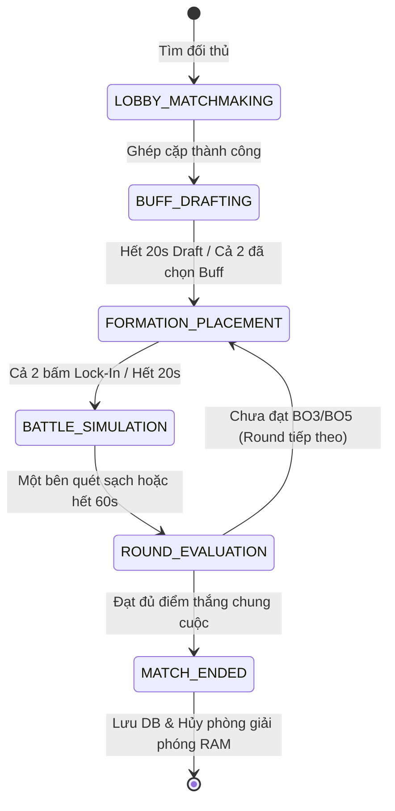

# 🔄 ĐẶC TẢ STATE MACHINES & VÒNG LẶP TICK TRẬN ĐẤU (STATE MACHINES SPECIFICATION)
*(Valkyrie Protocol: Zero • Phase 1 Deliverable • Chuẩn vận hành thời gian thực)*

---

## 1. STATE MACHINE PHÒNG ĐẤU 1v1 (MATCH ROOM LIFECYCLE)

---

## 2. CHU TRÌNH TICK 20HZ (50MS COMBAT ENGINE LOOP)

Mỗi tick 50ms, `CombatEngineService` của NestJS thực hiện 6 bước tuần tự:

1. **Mana Accumulation & Action Evaluation:**
   - Mỗi Valkyrie tích lũy 5 Mana/giây (0.25 Mana/tick) và hồi phục khi đánh hoặc nhận sát thương.
   - Nếu Mana = 100 $\rightarrow$ Kích hoạt trạng thái `CLIMAX_CASTING` và tạo sự kiện Cut-In.
2. **Target Acquisition:**
   - Ưu tiên mục tiêu cùng cột (Hàng 1 $\rightarrow$ Hàng 2 $\rightarrow$ Hàng 3). Nếu cột trống, nhắm mục tiêu gần nhất.
3. **Damage Calculation & Cloth Tear Checks:**
   - Tính toán sát thương vật lý/phép có giảm trừ giáp hyperbolic: $100 / (100 + \text{Armor})$.
   - Khi HP rơi xuống $< 70\%$ $\rightarrow$ Đổi trạng thái sang `Tier 2: Torn`.
   - Khi HP rơi xuống $< 30\%$ $\rightarrow$ Đổi trạng thái sang `Tier 3: Climax Extreme`.
4. **Collision & Movement Updates:**
   - Dịch chuyển theo vector vị trí $x, y$ nội suy.
5. **Death & Elimination Evaluation:**
   - Kiểm tra Valkyrie tử trận khi HP $\le 0$.
6. **Broadcast Snapshot:**
   - Đóng gói `S2C_COMBAT_SNAPSHOT` và phát sóng tới cả 2 Client qua WebSocket.
