# 🌸 BÁO CÁO PHÂN TÍCH KỸ THUẬT & KẾ HOẠCH BÓC TÁCH TÙY CHỈNH TOÀN DIỆN MODEL ZANE DENIA
*(VALKYRIE PROTOCOL: ZERO • 3D Character Engineering & Modular Customization Blueprint)*

---

## 📑 MỤC LỤC
1. [Tổng Quan Kỹ Thuật Mô Hình Denia (Denia_2.fbx)](#1-tổng-quan-kỹ-thuật-mô-hình-denia-denia_2fbx)
2. [Sơ Đồ Bóc Tách 6 Lớp Kiến Trúc Mô Hình (6-Layer Decoupling Architecture)](#2-sơ-đồ-bóc-tách-6-lớp-kiến-trúc-mô-hình)
3. [Bóc Tách Lớp 1: Khung Xương (Rigging), Xương Ngực 18+ & Động Lực Học](#3-bóc-tách-lớp-1-khung-xương-rigging-xương-ngực-18--động-lực-học)
4. [Bóc Tách Lớp 2: Hình Học Đa Giác (Polygon Topology & Submeshes)](#4-bóc-tách-lớp-2-hình-học-đa-giác-polygon-topology--submeshes)
5. [Bóc Tách Lớp 3: Bản Đồ Điểm Ảnh (Texture Maps & Pixel Pipeline)](#5-bóc-tách-lớp-3-bản-đồ-điểm-ảnh-texture-maps--pixel-pipeline)
6. [Bóc Tách Lớp 4: Vật Liệu 8 Slots & Công Nghệ Shaders Cel-Shading](#6-bóc-tách-lớp-4-vật-liệu-8-slots--công-nghệ-shaders-cel-shading)
7. [Bóc Tách Lớp 5: Hoạt Ảnh Động Lực Học Toàn Thân & Biểu Cảm Khuôn Mặt](#7-bóc-tách-lớp-5-hoạt-ảnh-động-lực-học-toàn-thân--biểu-cảm-khuôn-mặt)
8. [Bóc Tách Lớp 6: Bộ Hiệu Ứng Thị Giác (Combat VFX Suite) & Khí Lực Tụ Cầu](#8-bóc-tách-lớp-6-bộ-hiệu-ứng-thị-giác-combat-vfx-suite--khí-lực-tụ-cầu)
9. [Kế Hoạch & Thiết Kế Module Tùy Chỉnh Hoàn Hảo (Master Customization Blueprint)](#9-kế-hoạch--thiết-kế-module-tùy-chỉnh-hoàn-hảo)
10. [Lộ Trình Triển Khai Kỹ Thuật Vào Valkyrie3DStudio](#10-lộ-trình-triển-khai-kỹ-thuật-vào-valkyrie3dstudio)

---

## 1. TỔNG QUAN KỸ THUẬT MÔ HÌNH DENIA (`Denia_2.fbx`)

Mô hình **Denia** (từ kho lưu trữ mã nguồn mở nghệ thuật cao cấp của ZaneAtega) là một nữ chiến binh Anime 3D được điêu khắc với độ phân giải và chi tiết đạt chuẩn game console AAA:

- **Tên tệp gốc:** `Denia_2.fbx`
- **Kích thước tệp:** ~6.06 MB (6,065,148 bytes).
- **Tổng số đa giác (Polygon Count):** 226,242 Triangles.
- **Tổng số đỉnh (Vertex Count):** ~113,420 Vertices.
- **Hệ thống xương (Skeletal Rigging):** 84 Xương (Bip001 tiêu chuẩn + 4 Xương Ngực/Bust Physics + 24 Xương Tóc/Váy bay `Bone_Piao` + Twist bones chống gãy khối).
- **Hệ thống biểu cảm (Morph Targets):** Đầy đủ các kênh blendshape khuôn mặt (`E_Close_L/R` nhắm mắt, `M_Smile_L/R` nụ cười quyến rũ, v.v.).
- **Độ phân giải Textures:** 7 tệp kết cấu PNG 2K/4K chất lượng cực cao (Tổng dung lượng: ~23.3 MB).
- **Tỷ lệ chuẩn hóa (World Normalization):**
  - Chiều cao nguyên bản của mesh: 140.4 đơn vị FBX.
  - Hệ số co giãn chuẩn hóa (`scaleFactor`): $1.72 / 140.4 \approx 0.01225$.
  - Chiều cao thực tế sau chuẩn hóa trong Three.js: **1.72 mét**.
  - Căn chỉnh mặt sàn: Gót chân đặt chuẩn xác tại $Y = 0.000$.

---

## 2. SƠ ĐỒ BÓC TÁCH 6 LỚP KIẾN TRÚC MÔ HÌNH

Để cho phép người dùng tùy chỉnh (custom) toàn diện từ màu tóc, màu da, cấp độ rách giáp, trang phục, đến hiệu ứng vệt chém và góc xương, mô hình Denia được phân tách thành 6 tầng kiến trúc độc lập:

```mermaid
graph TD
    subgraph L6 [LỚP 6: HIỆU ỨNG THỊ GIÁC & HẠT - VFX & POST-PROCESSING]
        VFX1[Dual-Layer Crescent Slash Arc Ribbon]
        VFX2[Holographic Runic Floor Summoning Circle]
        VFX3[Triple Ground Shockwave Rings]
        VFX4[Dual-Layer Laser Energy Pillar]
        VFX5[96 Plasma Sparks & Energy Charge Aura]
    end

    subgraph L5 [LỚP 5: HOẠT ẢNH & BIỂU CẢM - ANIMATION & KINEMATICS]
        AN1[Idle Organic Breathing & 18+ Bust Jiggle]
        AN2[Trảm Kích: Windup -> Surge -> Hitstop -> Recovery]
        AN3[Tuyệt Kỹ Nộ: Charge -> Sky Vault -> Meteor Plunge]
        AN4[Facial Morph Blendshapes: Blinking, Seductive Smile]
    end

    subgraph L4 [LỚP 4: VẬT LIỆU & SHADERS - MATERIALS & CEL-SHADING]
        SH1[Gran Turismo Tonemapping GTTonemap]
        SH2[Anime Skin Toon Ramp with Soft Peach Shadow]
        SH3[Faction Cyberpunk Rim Lighting & Fresnel]
        SH4[Green Chroma Cutoff & Alpha Masking]
        SH5[Inverted Hull Ink Outlines]
    end

    subgraph L3 [LỚP 3: BẢN ĐỒ ĐIỂM ẢNH - TEXTURES & PIXEL PIPELINE]
        TX1[Face_D.png 1.25MB - Làn Da & Phấn Mắt]
        TX2[Eye_D.png 2.95MB - Đồng Tử Lấp Lánh Ánh Sao]
        TX3[Hair_D & Bangs_D 5.09MB - Mái Tóc & Vòng Thiên Thần]
        TX4[Cloth_D, Up_D, Down_D 13.98MB - Váy, Corset & Tất Ren]
    end

    subgraph L2 [LỚP 2: HÌNH HỌC ĐA GIÁC - GEOMETRY & SUBMESHES]
        GM1[226,242 Multi-Polygon High-Poly Mesh]
        GM2[8 Discrete Material Submesh Groups]
        GM3[Vertex Normals, Tangents & Skinning Weights]
    end

    subgraph L1 [LỚP 1: KHUNG XƯƠNG & ĐỘNG HỌC - SKELETAL RIGGING]
        SK1[Main Biped Skeleton: Pelvis, Spine 1-2, Head, Limbs]
        SK2[18+ Bust Bones: Bone_Chest001/002_L/R]
        SK3[Secondary Physics Bones: 24 Bone_Piao Hair/Ribbons]
        SK4[Twist Bones: Forearm & Thigh Anti-Deformation]
    end

    L1 --> L2
    L2 --> L3
    L3 --> L4
    L4 --> L5
    L5 --> L6
```



---

## 3. BÓC TÁCH LỚP 1: KHUNG XƯƠNG (RIGGING), XƯƠNG NGỰC 18+ & ĐỘNG LỰC HỌC

Hệ thống xương trong `Denia_2.fbx` bao gồm 84 xương với cấu trúc chuẩn Biped kết hợp các cụm xương chuyên biệt:

### 3.1. Phân Loại Danh Sách Khung Xương:

| Nhóm Xương | Tên Xương Cụ Thể Trong FBX | Chức Năng Kỹ Thuật & Tọa Độ Động Học |
| :--- | :--- | :--- |
| **Gốc Trọng Tâm (Root/Pelvis)** | `Root`, `Bip001Pelvis` (`腰`) | Điểm neo trọng tâm toàn thân. Điều khiển độ cao ($Y$), góc xoay hông ($Z, Y$) khi lấy đà và tiếp đất. |
| **Cột Sống & Cổ Đầu** | `Bip001Spine`, `Bip001Spine1`, `Bip001Spine2`, `Bip001Neck`, `Bip001Head` | Uốn cong ngực, xoay vặn thân trên khi vung kiếm, nghiêng đầu hiếu kỳ khi thở idle. |
| **Chi Trên (Tay & Vai)** | `Bip001L/RClavicle`, `Bip001L/RUpperArm`, `Bip001L/RForearm`, `Bip001L/RHand` | Giương kiếm Buster Greatsword ra sau vai, chém ngang ngực, giơ kiếm 2 tay lên đỉnh đầu. |
| **Bàn Tay & Ngón Tay** | `Bip001L/RFinger0..4` (15 xương mỗi bàn tay) | Co ngón tay bám chặt chuôi kiếm (Hilt), xòe bàn tay cân bằng khi lùi thế. |
| **Chi Dưới (Chân & Bàn Chân)** | `Bip001L/RThigh`, `Bip001L/RCalf`, `Bip001L/RFoot`, `Bip001L/RToe0` | Gập gối hạ tấn lunge, co gập 2 chân khi bật nhảy không trung, đạp gót tiếp đất 3 điểm. |
| **Xương Chống Xoắn Vặn (Twist)** | `Bip001RForeTwist1/2`, `Bip001LThighTwist1/2`, `Bip001_R/L_CalfTwist` | Giữ cho lớp da thịt ở cẳng tay và đùi không bị teo thắt (candy-wrapper artifact) khi xoay cổ tay/chân. |
| **Xương Ngực 18+ (Bust Physics)** | `Bone_Chest001_L`, `Bone_Chest002_L`, `Bone_Chest001_R`, `Bone_Chest002_R` | **Cốt lõi thẩm mỹ 18+:** Tạo dao động đàn hồi mềm mại (soft-body jiggle) theo quán tính di chuyển. |
| **Xương Tóc & Vạt Váy (Secondary)** | 24 Xương `Bone_Piao011..131_L/R/M` | Lan truyền sóng gió tự nhiên cho đuôi tóc, dải ruy-băng và mép váy khi chuyển động. |

### 3.2. Công Thức Vật Lý Dao Động Ngực 18+ (Spring-Damper Bust Kinematics):
Dao động ngực được tính toán theo mô hình con lắc đàn hồi suy giảm (Damped Harmonic Oscillator) kết hợp quỹ đạo Lissajous 2 pha:
$$\theta_{\text{pitch}}(t) = \theta_{\text{base}} + A_{\text{breath}} \cdot \sin(\omega_1 t - \phi_1) + A_{\text{accel}} \cdot \sin(2\pi \cdot p)$$
$$\theta_{\text{roll}}(t) = \theta_{\text{base}} \pm A_{\text{sway}} \cdot \cos(\omega_2 t - \phi_2)$$
Trong đó:
- Khi thở Idle: $A_{\text{breath}} = 0.038\text{ rad}$, $\phi_1 = 0.5\text{ rad}$ (trễ pha 0.23 giây so với lồng ngực tạo cảm giác nảy mềm tự nhiên).
- Khi Vung Kiếm (Slash): $A_{\text{accel}} = 0.22\text{ rad}$ nảy bùng nổ theo nhịp giải phóng đòn đánh.
- Khi Bị Đòn / Tiếp Đất: Rebound tức thời $+0.26\text{ rad}$ kèm dao động tắt dần tần số cao ($8\text{ Hz}$).

---

## 4. BÓC TÁCH LỚP 2: HÌNH HỌC ĐA GIÁC (POLYGON TOPOLOGY & SUBMESHES)

Mesh của Denia trong tệp FBX là một khối liên kết thống nhất được phân bổ thành 8 Submesh Material Slots để phân phối UV và vật liệu riêng biệt:

### 4.1. Bảng Phân Tích Thuộc Tính Hình Học Đỉnh (Vertex Attribute Buffers):

| Buffer Attribute | Kiểu Dữ Liệu | Kích Thước | Mục Đích Kỹ Thuật |
| :--- | :--- | :--- | :--- |
| `position` | `Float32BufferAttribute` | 3 (X, Y, Z) | Tọa độ không gian 3D của 113,420 đỉnh. |
| `normal` | `Float32BufferAttribute` | 3 (NX, NY, NZ) | Vector pháp tuyến bề mặt phục vụ Cel-Shading & Rim light. |
| `tangent` | `Float32BufferAttribute` | 4 (TX, TY, TZ, W) | Vector tiếp tuyến phục vụ Normal mapping và Anisotropic hair shine. |
| `uv` (Channel 0) | `Float32BufferAttribute` | 2 (U, V) | Tọa độ trải UV chính cho 7 tệp textures 2K/4K. |
| `uv2` (Channel 1) | `Float32BufferAttribute` | 2 (U, V) | Kênh UV phụ dùng cho Lightmaps, Fur textures hoặc Detail decals. |
| `skinIndex` | `Uint16BufferAttribute` | 4 (B0, B1, B2, B3) | 4 chỉ số xương tối đa ảnh hưởng lên từng đỉnh (Skinning). |
| `skinWeight` | `Float32BufferAttribute` | 4 (W0, W1, W2, W3) | Trọng số biến dạng của 4 xương tương ứng ($\sum W_i = 1.0$). |

---

## 5. BÓC TÁCH LỚP 3: BẢN ĐỒ ĐIỂM ẢNH (TEXTURE MAPS & PIXEL PIPELINE)

7 tệp Textures trong `apps/client/public/models/textures/Denia_2/` chứa toàn bộ dữ liệu điểm ảnh tạo nên thần thái của Denia:

| Tên Tệp Texture | Dung Lượng | Kênh Màu | Chức Năng Thẩm Mỹ & Vùng Che Phủ |
| :--- | :--- | :--- | :--- |
| `T_R2T1DaniyaMd10011Face_D.png` | **1.25 MB** | sRGB | **Khuôn Mặt & Làn Da Sứ:** Mắt ngọc, chân mày, má hồng e thẹn, bờ môi căng mọng. Không bị gắt bóng. |
| `T_R2T1DaniyaMd10011Eye_D.png` | **2.95 MB** | sRGB | **Đồng Tử Anime Thần Thái:** Tròng mắt đa tầng với ánh sao phản quang, không phụ thuộc đèn ngoài (Unshaded Emissive). |
| `T_R2T1DaniyaMd10011Bangs_D.png` | **2.45 MB** | sRGB | **Mái Tóc Trước:** Tóc mai ôm sát gò má, có vệt sáng thiên thần (Angel Ring Highlight). |
| `T_R2T1DaniyaMd10011Hair_D.png` | **2.63 MB** | sRGB | **Mái Tóc Sau & Đuôi Tóc:** Khối tóc bồng bềnh, hỗ trợ đổ bóng Cel-shading bậc thang. |
| `T_R2T1DaniyaMd10011Up_D.png` | **4.65 MB** | sRGB + Alpha | **Thân Trên (Corset & Bodice):** Áo ngực cúp sâu quyến rũ, nơ thắt eo, viền kim loại mạ vàng. |
| `T_R2T1DaniyaMd10011Down_D.png` | **4.06 MB** | sRGB + Alpha | **Thân Dưới (Skirt & Stockings):** Váy xòe xếp ly, vớ đùi lụa đen bóng mờ, đai kẹp vớ garter gợi cảm. |
| `T_R2T1DaniyaMd10011Cloth_D.png` | **5.26 MB** | sRGB + Alpha | **Áo Choàng & Ruy-Băng:** Tà áo dạ tiệc lộng lẫy, dải lụa bay mềm mại quanh cánh tay. |

---

## 6. BÓC TÁCH LỚP 4: VẬT LIỆU 8 SLOTS & CÔNG NGHỆ SHADERS CEL-SHADING

Mô hình Denia sử dụng mảng vật liệu đa thành phần (Multi-Material Array) tương ứng với 8 Material Slots trong FBX:

```typescript
const materialsList: THREE.Material[] = [
  matFace,  // Slot 0: Khuôn mặt (Porcelain Skin Toon Ramp, NO Rim Light)
  matCloth, // Slot 1: Vải váy & Choàng (Dress Fabric + Cyberpunk Faction Rim)
  matFx,    // Slot 2: Lưới voan phụ kiện (Transparent Cutout, giải phóng vùng cổ & ngực)
  matEye,   // Slot 3: Mắt Anime (Unshaded Emissive Starry Eyes)
  matBangs, // Slot 4: Tóc mái trước (Cel-Shading + Hair Edge Rim Highlight)
  matHair,  // Slot 5: Tóc bồng bềnh phía sau (Volumetric Cel-Shading)
  matUp,    // Slot 6: Thân trên & Áo cúp ngực (Bodice & Collar)
  matDown   // Slot 7: Thân dưới & Tất chân (Skirt, Stockings & Heels)
];
```

### 6.1. Thuật Toán Cel-Shading & Rim-Light Đỉnh Cao:
1. **Skin Toon Ramp (GradientMap):** Thay vì làm tối tuyến tính gây bẩn mặt nhân vật, chuyển màu da sử dụng Texture Ramp 3 dải màu: Màu da chính ($0\text{xfff6f2}$) $\rightarrow$ Dải chuyển tiếp màu đào nhạt (Soft Peach) $\rightarrow$ Bóng tối màu cánh sen nhạt ($0\text{xead0c8}$).
2. **GPU Fresnel Rim-Light:**
   Công thức ánh sáng viền hào quang điện ảnh:
   $$I_{\text{rim}} = \left( 1.0 - \max(0.0, \mathbf{N} \cdot \mathbf{V}) \right)^{\text{power}} \cdot \text{strength}$$
   - Trên tóc: $\text{power} = 4.2$, $\text{strength} = 0.28$, màu viền biến đổi theo Faction (Hồng Neon Abyssal / Vàng Kim Sol).
   - Trên trang phục: $\text{power} = 3.8$, $\text{strength} = 0.35$.
3. **Cơ Chế Rách Giáp 3 Cấp Độ (3-Tier Cloth Damage):**
   - **Tier 1 (Pristine):** Toàn bộ vải áo opaque 100%, bảo vệ tuyệt đối.
   - **Tier 2 (Torn Armor):** `matCloth.opacity = 0.78`, `matUp.opacity = 0.82` (áo rách nứt, lộ làn da lấp ló).
   - **Tier 3 (Climax Extreme):** `matCloth.opacity = 0.45`, `matUp.opacity = 0.52`, `matDown.opacity = 0.55` (rách toạc cực hạn, trong suốt xuyên thấu tôn vinh đường cong quyến rũ).

---

## 7. BÓC TÁCH LỚP 5: HOẠT ẢNH ĐỘNG LỰC HỌC TOÀN THÂN & BIỂU CẢM KHUÔN MẶT

### 7.1. Hoạt Ảnh Trảm Kích (Attack Animation - 0.95s):
Được thiết kế chuẩn nhịp điệu Anime Fighting Games với 4 pha rõ rệt:
1. **Pha 1: Wind-up (Lấy đà nén lực, $0.00\text{s} \to 0.26\text{s}$):**
   - Trọng tâm hạ thấp $Y - 0.08\text{m}$, lùi sau $Z - 0.16\text{m}$.
   - Khớp gối trái/phải gập sâu ($+0.50 / +0.40\text{ rad}$), cột sống xoay vặn $-0.75\text{ rad}$.
   - Hai tay đưa Đại Kiếm Buster Greatsword ra sau vai phải, đầu ghim chặt ánh mắt về phía trước.
   - Cơ ngực nén nhẹ chuẩn bị bộc phát.
2. **Pha 2: Slash Strike (Bứt tốc chém bộc phá, $0.26\text{s} \to 0.58\text{s}$):**
   - Bứt tốc lao lên phía trước $Z + 0.65\text{m}$.
   - Chân trái lunge lao lên trước, chân phải đạp trụ sau.
   - Cột sống quất mạnh từ $-0.75\text{ rad}$ sang $+1.00\text{ rad}$.
   - Đại kiếm quét một vòng cung chém ngang ngực $240^\circ$ cực nhanh.
   - **Xương ngực nảy giật cực đại ($0.22\text{ rad}$) theo lực ly tâm!**
   - Tóc và ruy-băng bay xòe theo gió. Kích hoạt vệt sáng lưỡi liềm và 96 tia lửa plasma!
3. **Pha 3: Hitstop / Impact Frame (Khựng đòn anime, $0.58\text{s} \to 0.72\text{s}$):**
   - Khựng dừng hình $0.14\text{s}$ tại đỉnh kiếm kèm vi dao động ($80\text{ Hz}$) tạo cảm giác lưỡi kiếm chém trúng giáp đối thủ cực nặng tay!
4. **Pha 4: Recovery (Thu kiếm hồi thế, $0.72\text{s} \to 0.95\text{s}$):**
   - Đứng thẳng mượt mà, đại kiếm hạ về bên hông, ngực thở ra nhẹ nhõm.

### 7.2. Hoạt Ảnh Tuyệt Kỹ Nộ (Ultimate Climax - 1.75s):
1. **Pha 1: Divine Charge ($0.00\text{s} \to 0.32\text{s}$):**
   - Hạ người tụ lực, kiếm cắm đất. Vòng ma trận Hologram xoay tít dưới chân, hạt năng lượng cuộn xoáy vào ngực.
2. **Pha 2: Sky Vault ($0.32\text{s} \to 0.72\text{s}$):**
   - Bật nhảy thăng thiên vút lên không trung $Y + 1.35\text{m}$.
   - **Hai đầu gối co gập sống động trên không** (không còn bị đơ chân), mũi chân duỗi thẳng.
   - Hai tay nâng Đại Kiếm giương cao quá đầu. Ngực nảy vồng lên, tóc bay dựng ngược lộng gió!
3. **Pha 3: Meteor Plunge Cleave ($0.72\text{s} \to 1.05\text{s}$):**
   - Lao bổ thẳng đứng như thiên thạch cắm phập lưỡi kiếm xuống mặt sàn ($Y - 0.15\text{m}$).
   - Thế tiếp đất 3 điểm (Superhero Landing): đầu gối trái quỳ sát sàn, chân phải choàng rộng.
   - Kích hoạt địa chấn: 3 vòng sóng xung kích mở rộng, cột năng lượng laser trắng xóa dựng cao 4.2m, 96 tia lửa plasma nổ tung!
4. **Pha 4: Heroic Rise ($1.05\text{s} \to 1.75\text{s}$):**
   - Đứng dậy uy nghi tuyệt mỹ, kiếm đưa về vị trí chờ lệnh.

---

## 8. BÓC TÁCH LỚP 6: BỘ HIỆU ỨNG THỊ GIÁC (COMBAT VFX SUITE)

Hệ thống VFX được cấu thành từ 6 thực thể đồ họa Three.js độc lập:
1. **Vệt Chém Lưỡi Liềm Kép (Dual-Layer Crescent Slash Arc):**
   - Lớp ngoài: Ribbon dải sáng neon faction màu sắc rực rỡ ($1.85\text{m}$).
   - Lớp trong: Lưỡi cắt laser trắng sáng tinh khiết ($1.45\text{m}$) tạo độ sắc bén vô song.
2. **Vòng Trận Pháp Hologram Dưới Chân (Holographic Floor Runic Circle):**
   - Đường kính $2.4\text{m}$, 6 nút lục giác công nghệ xoay tròn phát sáng khi tụ lực và tiếp đất.
3. **Sóng Xung Kích Địa Chấn 3 Tầng (Triple Shockwave Rings):**
   - Vòng 1 ($0.55\text{m}$) trắng sáng $\rightarrow$ Vòng 2 ($0.85\text{m}$) màu neon $\rightarrow$ Vòng 3 ($1.15\text{m}$) gợn sóng lan tỏa nhanh.
4. **Trụ Năng Lượng Thiên Thần Lõi Kép (Dual-Layer Energy Blast Pillar):**
   - Trụ ngoài: Khí xoáy neon hình trụ xoay quanh trục ($4.2\text{m}$).
   - Trụ lõi: Tia laser trắng đặc ($4.4\text{m}$) phóng thẳng lên trời.
5. **Hệ Thống 96 Tia Lửa Plasma (Radial Sparks System):**
   - Hạt ánh sáng có vận tốc ban đầu ngẫu nhiên, chịu gia tốc trọng trường ($g = -7.5\text{ m/s}^2$) và lực cản không khí.
6. **Vòng Xoáy Hào Quang Năng Lượng (Energy Charge Aura):**
   - 36 hạt phát quang bay theo quỹ đạo xoắn ốc hình phễu cuộn vào lồng ngực.

---

## 9. KẾ HOẠCH & THIẾT KẾ MODULE TÙY CHỈNH HOÀN HẢO (MASTER CUSTOMIZATION BLUEPRINT)

Để biến Denia thành một nền tảng nhân vật có thể tùy biến 100% mọi chi tiết theo ý muốn của người chơi, chúng ta xây dựng module quản lý `DeniaCustomizerController`:

```
┌────────────────────────────────────────────────────────────────────────┐
│                   DENIA MASTER CUSTOMIZER CONTROLLER                   │
├───────────────────┬───────────────────┬────────────────────────────────┤
│ 1. POLYGON / MESH │ 2. PIXEL / TINT   │ 3. SHADER & VISUAL EFFECTS     │
│ - Tách/Ẩn Váy     │ - Đổi Màu Da      │ - Tùy chỉnh Độ Mờ Rách Giáp    │
│ - Tháo Ruy-Băng   │ - Đổi Màu Tóc     │ - Điều chỉnh Độ Dày Ink Outline│
│ - Hoán đổi Kiếm   │ - Đổi Màu Mắt     │ - Tăng/Giảm Rim Light Fresnel  │
│ - Đổi Đôi Cánh    │ - Đổi Màu Vải Áo  │ - Màu Hào Quang Faction Neon   │
├───────────────────┼───────────────────┼────────────────────────────────┤
│ 4. SKELETAL RIG   │ 5. FACIAL MORPHS  │ 6. VFX & COMBAT MOTION         │
│ - Chỉnh Góc Ngực  │ - Nháy Mắt Blink  │ - Đổi Tốc Độ Chém (0.5x - 2.0x)│
│ - Chỉnh Vòng Eo   │ - Cười Quyến Rũ   │ - Kích Cỡ Sóng Nổ Shockwave    │
│ - Độ Nảy Jiggle   │ - Mắt Trợn Chiến  │ - Số Lượng Hạt Tia Lửa (48-128)│
└───────────────────┴───────────────────┴────────────────────────────────┘
```

### 9.1. Lập Trình Giao Diện Tùy Chỉnh (TypeScript Specification):

```typescript
export interface DeniaCustomizationState {
  // 1. Màu Sắc & Điểm Ảnh (Pixels & Colors)
  readonly skinTone: string;        // Ví dụ: '#fff6f2' (Trắng hồng), '#fce0d6' (Mật ong)
  readonly hairColor: string;       // Ví dụ: '#4a3f6b' (Tím khói), '#ffb6c1' (Hồng phấn), '#ffd700' (Bạch kim)
  readonly eyeColor: string;        // Ví dụ: '#00f0ff' (Cyan), '#ff0055' (Hồng ruby)
  readonly clothBaseColor: string;  // Ví dụ: '#181a28' (Đen huyền bí), '#ffffff' (Thánh khiết)
  readonly factionNeonColor: string;// Ví dụ: '#00F0FF', '#FF2A85', '#FFD700'

  // 2. Độ Rách Giáp Từng Vị Trí Cụ Thể (Localized Cloth Damage)
  readonly chestTornOpacity: number; // 1.0 (Nguyên vẹn) -> 0.3 (Xuyên thấu gợi cảm)
  readonly skirtTornOpacity: number; // 1.0 (Nguyên vẹn) -> 0.4 (Rách tà)
  readonly isFxVeilVisible: boolean; // Ẩn/Hiện mạng che ngực

  // 3. Đa Giác & Phụ Kiện (Geometry Toggles)
  readonly isGreatswordVisible: boolean;
  readonly isHaloVisible: boolean;
  readonly bustJiggleMultiplier: number; // 0.0 (Tắt) -> 2.5 (Siêu nảy bùng nổ)

  // 4. Biểu Cảm Khuôn Mặt (Facial Morph Weights)
  readonly smileWeight: number;      // 0.0 -> 1.0
  readonly blushWeight: number;      // 0.0 -> 1.0 (Má ửng hồng quyến rũ)
}
```

---

## 10. LỘ TRÌNH TRIỂN KHAI KỸ THUẬT VÀO VALKYRIE3DSTUDIO

1. **Bước 1 (Đã hoàn thành):** Nâng cấp hoạt ảnh toàn thân, cử động chân, gập gối, tiếp đất, dao động ngực 18+ và bộ VFX 6 lớp đỉnh cao vào `valkyrie-fbx-loader.ts` và `valkyrie-combat-vfx.ts`.
2. **Bước 2 (Tiếp theo):** Bổ sung bảng điều khiển **"TÙY CHỈNH CHI TIẾT (CUSTOMIZE LAB)"** trên giao diện [Valkyrie3DStudio.tsx](file:///c:/Users/ADMIN/Desktop/18+game/apps/client/src/components/Valkyrie3DStudio.tsx):
   - Cho phép người chơi tự tay click đổi bảng màu (Palette Swatch).
   - Thanh trượt chỉnh độ nảy ngực (Bust Jiggle Intensity Slider).
   - Thanh trượt độ xuyên thấu rách giáp (Cloth Sheer Slider).
   - Bộ chọn biểu cảm khuôn mặt tức thì.
3. **Bước 3:** Kiểm tra Playtest trên trình duyệt bằng `browser_subagent` để đảm bảo mượt mà 60 FPS không giật lag.
